# Échantillons des vues001–048

Seize extraits ont servi à l’étude préparatoire de neuf photographies entières ; cinq autres documentent les corrections apparues pendant la relecture. Les formes et leurs réserves sont décrites dans [observations.json](observations.json).

## Vue 002 : 25 Ma. / Juillet 1916

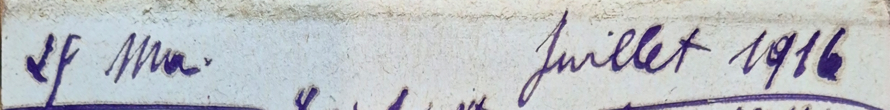

Le 2 commence en boucle descendante ; Ma. est une contraction de mardi. Comparer les dates suivantes, sans développer les noms dans le texte.

## Vue 002 : Levé [dès ?] 8 H m. / Bien reposé

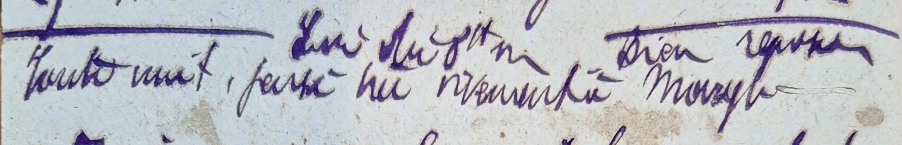

Le H se distingue des lettres courantes par sa hauteur ; la liaison avant 8 demeure discutée.

## Vue 002 : lieutt Curtis au village de [Sercus ?]

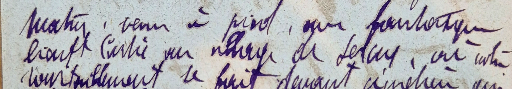

La finale du grade est suscrite ; la graphie du nom Curtis peut se comparer à la contraction Ctis de la vue023. Le toponyme reste proposé.

## Vue 004 : Tjours même temps gris et / saturé de mélancolie

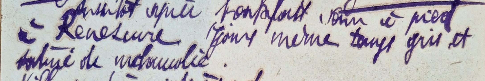

Le groupe jours est resserré et abrégé ; les pleins d’encre ne se confondent pas avec une rature.

## Vue 004 : Eglise m’a aussi retenu lgt — Double nef

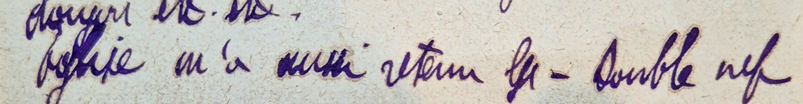

lgt porte une finale en hauteur ; le groupe vaut longtemps dans cette phrase, sans rétablissement silencieux des lettres absentes.

## Vue 007 : Tip à Hancock, headcook : 5 f

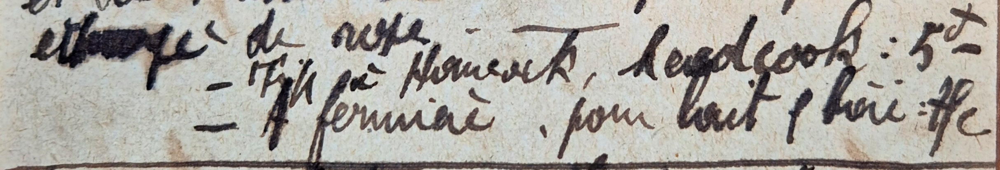

Le h anglais présente une grande hampe ; la finale cook et le montant peuvent être distingués malgré la liaison.

## Vue 016 : lgt av. l’éclusier de notre gal / en chef, Maxse etc

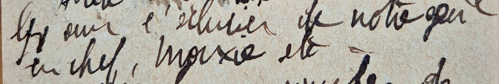

Le x du nom est formé par deux mouvements et le s s’enchaîne au e ; ne pas transformer toute lettre croisée en x.

## Vue 023 : M. Barbry — y [suppression] amené / adjudants Lupin & Schumacher

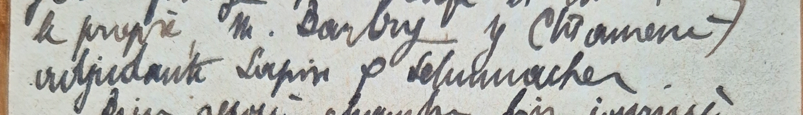

Le y devant amené peut être pronominal ; la coordination anglaise/française n’impose pas de lire toutes les formes analogues &.

## Vue 023 : Fin jour très belle mervx sunset

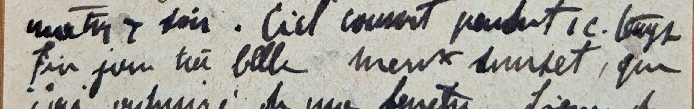

La finale de merveilleux est contractée ; le x resserré est à comparer au x de Maxse, sans identité mécanique des tracés.

## Vue 030 : giboulées & éclaircies

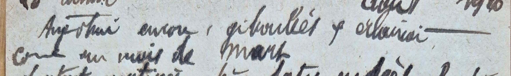

Le signe de coordination a une descente et peut ressembler au y. La construction permet d’en déterminer ici la fonction, pas de définir un alphabet universel.

## Vue 030 : Aucun confort. Jamais + mal logé

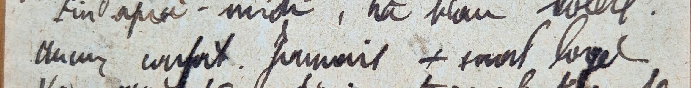

Le + représente plus dans le comparatif. Le signe n’indique pas une addition comptable dans cet emploi.

## Vue 036 : tout jaunes — et qui / bruissaient monotone

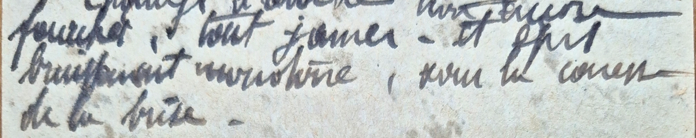

Le q descend à partir d’un petit corps et le ui est comprimé. Cette construction relative peut être confrontée aux qui des vues002 et048 ; l’accord elliptique reste celui du diariste.

## Vue 041 : Chevauché matinée entière — Après 3 H soir

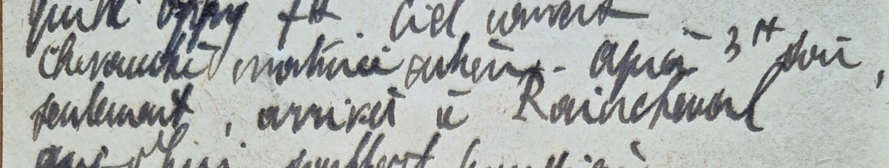

Matinée entière reste écrit sans pronom ni auxiliaire. Le H de l’heure ne transforme pas entière en un chiffre de durée.

## Vue 041 : Tip au groom Connelly : 1 f / Oeufs / cartes ples

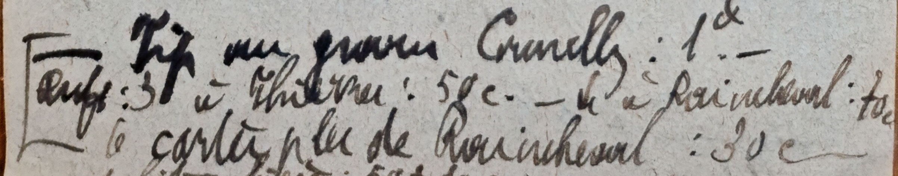

Le crochet autographe à gauche rassemble les comptes ; il ne marque pas une perte du texte. La finale de cartes postales est contractée.

## Vue 048 : Levé 6 H 1/2 / Vers 7 H 1/2 / départ fixé à 9 H 30

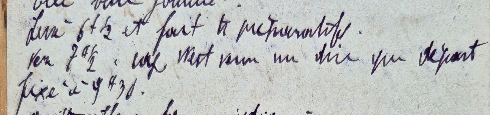

Les fractions et H peuvent être suscrits. On conserve les heures écrites, sans imposer un itinéraire ou un temps de route.

## Vue 048 : hutte avec épaisse[bâche?] / verte cme litière

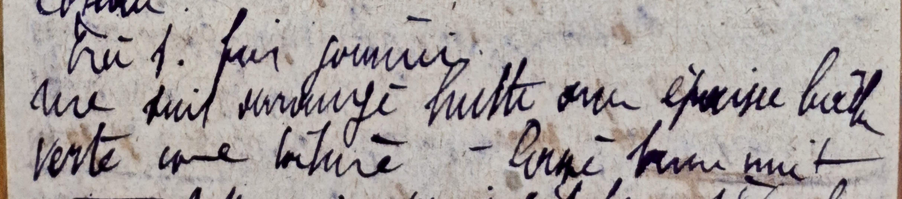

Litière est confirmé par l’attaque l, le t barré et la finale ère. Le mot de matière bâche reste proposé : attaque b/h, corps resserré et finale che. Deux avis indépendants maintiennent la réserve.

## Vue 005 : au terme voyage

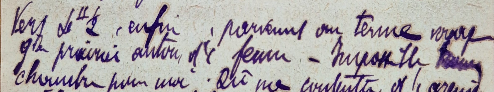

Le v initial, le y descendant et la finale age sont visibles ; conserver l’ellipse sans de.

## Vue 024 : Emballage au départ :50c

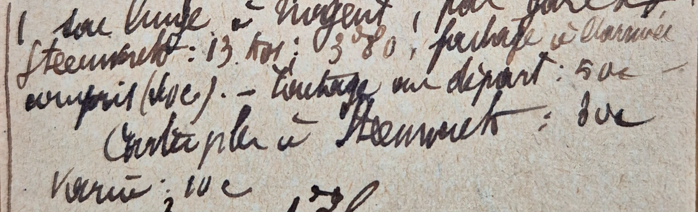

E initial ample, m, b haut et finale allage : la nouvelle comparaison écarte Timbrage.

## Vue 025 : ft[?] de bien à mon moral

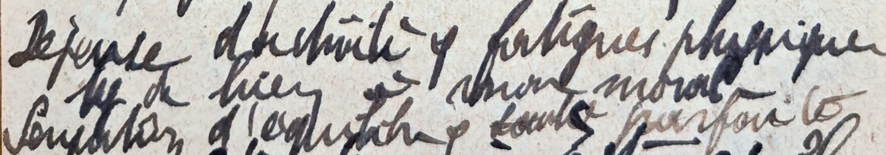

Le premier trait est saturé ; ft(fait) est proposé avec réserve, non bp(beaucoup) assuré.

## Vue 028 : Pluie nous a trempé j’à la peau

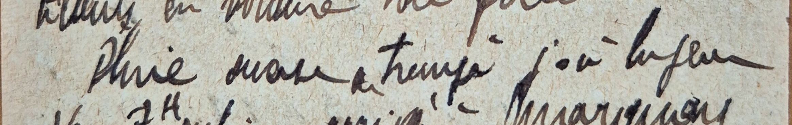

Nous a est visible avant trempé. Le groupe ne donne pas ne cesse.

## Vue 032 : sous-préf[re?] de5000habts ;1697

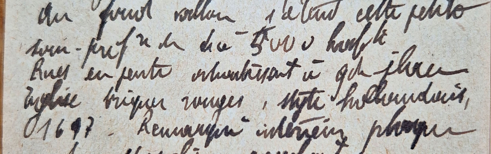

La petite finale surélevée dépend de sous-préfecture. Aucun4à distinct n’est confirmé. Le9 de1697 est saturé, ce qui avait pu le faire prendre pour4.
